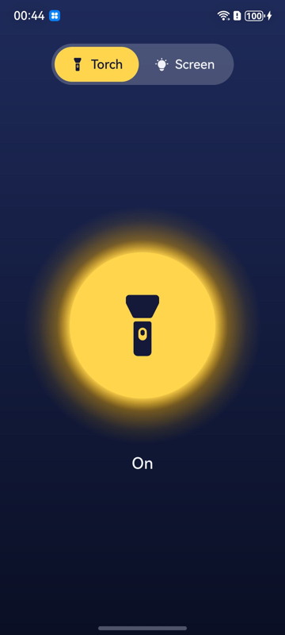
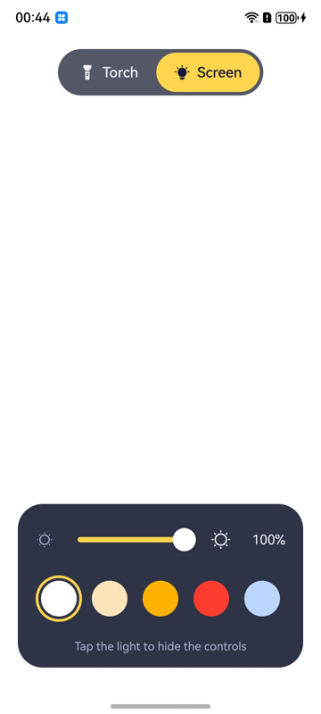
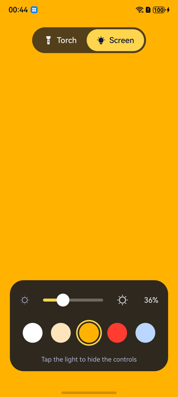

# Super Bright Flashlight

A flashlight for OpenHarmony with two lights:

* **Torch**: the camera flash LED. One big button switches it on and off.
  The torch stays on after the app is closed. The button follows the camera
  service, so it also shows changes made from the Control Center or by
  another app. While an app has the camera that owns the LED open, the torch
  is unavailable and the app says so.
* **Screen**: the display as a soft light, for devices without a flash or
  when the LED is too harsh. Choose its brightness and its colour (white,
  warm white, amber, red for night vision, cool blue). Tap the light to hide
  the controls and the status bar. The screen stays awake while the light is
  shown. Only this app's window changes, so the system brightness is not
  touched and comes back when you leave.

Devices without a flash open straight on the screen light. Otherwise the app
opens on the light used last, with the last brightness and colour.

<p float="left">
  
  
  
</p>

It needs no permissions: the torch API (`CameraManager.setTorchMode`) and
window brightness are open to every app.

## Build

Stage model, ArkTS. It compiles against API 23 (OpenHarmony 6.1 SDK) and runs
on API 12 (OpenHarmony 5.0) and later.

The LED has no brightness control: the API for it
(`setTorchModeOnWithLevel`) is open to apps only from API 26, and the store's
build toolchain cannot load the API 26 SDK yet.

```
ohpm install
hvigorw assembleHap --mode module -p product=default -p buildMode=release --no-daemon
```

To install it on a device for testing, sign it with the OpenHarmony
development key (`oniro-app sign .`) and run `hdc install`.

## Releases

Pushing a version tag (`v1.2.3`) builds the app on GitHub from that commit and
publishes it to the [Oniro App Store](https://store.iparo.app)
(`.github/workflows/oniro-store.yml`). Bump `versionCode` and `versionName` in
`AppScope/app.json5` first.

Oniro images also preinstall it from a pinned commit (`oniro-haps.json` in
[vendor_oniro](https://github.com/eclipse-oniro4openharmony/vendor_oniro)).

## History

The app started as a demo of the torch API. Version 1.1.0 merged in the Oniro
Flashlight (`org.oniroproject.flashlight`, formerly
github.com/frankplus/oniro-flashlight), whose history is kept in this
repository.

## License

Apache-2.0, see [LICENSE](LICENSE).
